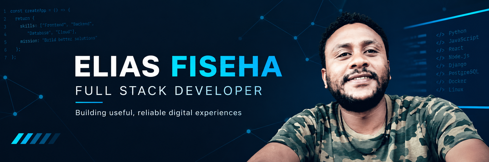

  <!-- Optional banner: add banner.png to the repository root to display it -->

<h1>Hi, I'm Elias Fiseha 👋</h1>
  <h3>Full-Stack Developer | ALX Graduate | Lifelong Learner</h3>

    
    
    
  

---
🚀 About Me
I'm a full-stack developer from Addis Ababa, Ethiopia, continuing to develop my skills in modern web technologies and systems engineering.
💻 Experience with Python, JavaScript, Flask, Django, and Node.js
⚙️ Comfortable with low-level programming, including C and Bash
🗄️ Interested in databases, SQL, and RESTful APIs
🐧 Familiar with Linux, Docker, and cloud fundamentals
🌱 Currently learning React and continuously improving my skills
🎨 Outside of coding, I enjoy charcoal and pencil drawing, reading, and football
> I enjoy building useful software, solving challenging problems, and collaborating on projects that make a difference.
---
⚠️ Previous GitHub Account
I currently cannot access my previous GitHub account because of two-factor authentication recovery issues.
My previous repositories, including older ALX and low-level programming projects, may still be available here:
github.com/malu17
---
🛠️ Languages & Tools

  
  
  
  
  
  
  
  
  
  
  
  

---
📊 GitHub Stats

  
  

---
📫 Connect With Me
Email: tecaddis@gmail.com
Twitter: @eliasfiseha1
Previous GitHub account: github.com/malu17
---

  
    
  <em>Thanks for stopping by! Let's build something great together 🚀</em>

